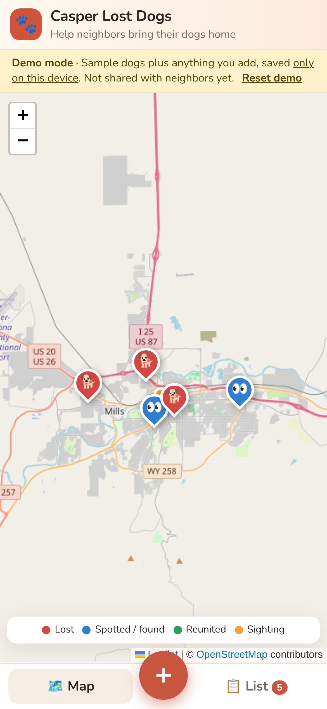

# Casper Lost Dogs 🐾

A community map for lost and found dogs in Casper, WY. Neighbors can report a **lost** dog or a dog they **spotted/found**, see every report on a map, add **"I saw this dog"** sightings that build a trail, and mark dogs **Reunited**.

* **Open the app:** https://burkemorin-sys.github.io/casper-lost-dogs/
* **Android APK:** https://github.com/burkemorin-sys/casper-lost-dogs/releases/latest/download/casper-lost-dogs-debug.apk

 

Print the QR code (`screenshots/qr.png`) on lost-dog flyers so neighbors can open the map from their phone camera.

## Put it on your phone

### iPhone / iPad
1. Open **https://burkemorin-sys.github.io/casper-lost-dogs/** in **Safari**. Other iPhone browsers may not offer this option.
2. Tap the **Share** button (the square with an arrow, at the bottom of the screen).
3. Scroll down, tap **Add to Home Screen**, then tap **Add**.
4. Open **Lost Dogs** from your home screen. It runs full screen like a regular app and still opens when you're offline.

### Android, option A: install from Chrome (recommended)
1. Open **https://burkemorin-sys.github.io/casper-lost-dogs/** in **Chrome**.
2. Tap **📲 Install app** at the top of the page, or open Chrome's **⋮** menu and choose **Install app** / **Add to Home screen**.

### Android, option B: the APK file
1. On the phone, open **https://github.com/burkemorin-sys/casper-lost-dogs/releases/latest/download/casper-lost-dogs-debug.apk**. It downloads the app file.
2. Open the downloaded file. If Android asks, allow **Install unknown apps** for your browser or Files app, then tap **Install**.
3. This is a *debug* build, signed with a public test key and not published on Google Play, so Play Protect may show a warning. Tap **More details > Install anyway**. Newer APKs from this page install over older ones.

## Demo mode vs. shared reports

**Until a database is connected, the app runs in demo mode.** A yellow **Demo mode** banner shows the 6 sample Casper dogs, and anything you add is saved **only on that phone or browser**. Your neighbors won't see it.

To make reports shared by everyone, connect a free [Supabase](https://supabase.com) database. It takes about 10 minutes:

1. Sign up at **supabase.com** and click **New project**. The free plan is fine. Pick a name, a database password, and the region closest to Wyoming (e.g. *West US*).
2. When the project is ready, open **SQL Editor > New query**. Paste the whole contents of [`supabase/schema.sql`](supabase/schema.sql) and click **Run**. This creates:
   * `reports` and `sightings` tables, readable by everyone
   * functions `create_report`, `add_sighting` and `reunite_report`, the only way the public can write. They check the input, and reuniting requires the owner key.
   * a hidden `report_owner_keys` table. It stores only a hash of each owner key and is never readable by the public.
   * a public **`dog-photos`** storage bucket (images only, up to 6 MB, upload-only for the public)
3. Go to **Project Settings > API** (or **Connect**). Copy the **Project URL** and the **anon / publishable** key. Do **not** use the `service_role` / secret key.
4. In this repo on GitHub, open [`public/config.js`](public/config.js), click the ✏️ pencil, and fill in:
   ```js
   supabaseUrl: 'https://YOUR-PROJECT.supabase.co',
   supabaseAnonKey: 'YOUR-ANON-OR-PUBLISHABLE-KEY',
   ```
   Then click **Commit changes**. The anon key is designed to be public, and the security comes from the row-level security rules in `schema.sql`.
5. Publish the change. With the Actions workflows switched on (see *Publishing* below), GitHub Pages redeploys on its own in about a minute. Until they're switched on, run `scripts/deploy-pages.sh` from a clone to copy the change to the live site. Switching on the workflows first is easier. Reload the app: the demo banner is gone and reports are shared. Installed phone apps pick up the change the next time they open with internet.
6. **Android APK users:** the APK contains its own copy of `config.js`, so it needs a rebuild. With the APK workflow switched on, publish a new release with a new tag such as `v1.0.1` (**Releases > Draft a new release**), and the APK builds and attaches itself. Without it, run `scripts/build-apk.sh` and upload `dist/casper-lost-dogs-debug.apk` to a new release. Android users who installed from Chrome (option A) don't need this, because they get the update on their own.

Good to know: the shared map starts empty because the samples are demo-only. Contact details people enter are public, so the report form says so. Moderate posts from the Supabase **Table Editor**, where you can delete a row to remove a spam report.

## How it's built

```
public/                  the app (plain HTML/CSS/JS + Leaflet, no build step)
  index.html, app.js     UI
  data.js                pluggable data layer: Supabase | Node server | demo (localStorage)
  config.js              backend settings (Supabase URL + anon key)
  seed.js                sample Casper dogs (used by demo mode and the Node server)
  manifest.json, sw.js   PWA: installable, offline app shell, map tile cache
  icons/                 app icons (any + maskable, apple-touch-icon)
supabase/schema.sql      tables, RLS policies, RPC functions, photo bucket
capacitor/               wraps public/ into an Android app (Capacitor)
ci/workflows/            GitHub Actions workflows, ready to switch on (see below)
  pages.yml              deploys public/ to GitHub Pages on every push to main
  android-apk.yml        on a v* tag: builds the debug APK and attaches it to the Release
server.js                optional zero-dependency Node server for self-hosting
scripts/build-apk.sh     builds the APK on your own computer (Node 22, JDK 21, Android SDK)
scripts/deploy-pages.sh  publishes public/ to the gh-pages branch
scripts/make-icons.py    regenerates the icons (Python + Pillow)
```

### Publishing: how it works today, and turning on automatic builds

The site is served by GitHub Pages from the **`gh-pages`** branch, which holds a copy of `public/`. The v1.0.0 APK was built with `scripts/build-apk.sh` and attached to the release by hand.

The two GitHub Actions workflows in `ci/workflows/` automate both steps. They're stored outside `.github/workflows/` because the token used for the first upload wasn't allowed to add workflow files. To switch them on:

1. On GitHub, use **Add file > Create new file** to create `.github/workflows/pages.yml` and `.github/workflows/android-apk.yml`, and paste in the contents of the matching files from `ci/workflows/`. You can also move them in a local clone that has `workflow` permission.
2. Go to **Settings > Pages > Build and deployment > Source** and choose **GitHub Actions**.

After that, every push to `main` redeploys the site, and every new `v*` tag builds a new APK and attaches it to that release.

**Which backend runs?** `config.js` has `backend: 'auto'`. The app uses Supabase if the URL and key are set. Otherwise it uses the Node server when it's served by `npm start`, and falls back to demo mode everywhere else. You can force one with `'supabase'`, `'server'` or `'demo'`.

**Updating the app:** edit files in `public/` and push to `main`. Pages redeploys if the workflow is on; otherwise run `scripts/deploy-pages.sh`. If you change shell files, bump `VERSION` in `public/sw.js` so installed copies refresh quickly. Push a new `v*` tag for a new APK.

## Self-hosting with the Node server (optional)

You need Node.js 18 or newer. There's nothing to install because it has no npm dependencies.

```bash
npm start            # or: node server.js
# open http://localhost:3000
```

* `PORT=8080 npm start` runs it on a different port. `node server.js --reset` restarts with fresh sample data.
* Reports are saved to `data/db.json` and photos to `uploads/`. Back up both.
* With Supabase left empty in `config.js`, the page uses this server's API, so reports are shared by everyone who uses that server. Put it behind HTTPS (e.g. on Render, Railway, Fly.io or a small VPS) so phones can install it and use "Use my location".

## Features

* **Map** (Leaflet + OpenStreetMap, no API keys). Red pins are lost dogs, blue pins are spotted/found dogs, green pins are reunited dogs, and orange dots are sightings joined by a dashed trail.
* **Report form**: lost or spotted, name (optional for spotted dogs), breed, color/markings, notes, photo (resized in the browser before upload), last-seen date and time, contact name plus phone or email. Set the location by tapping the mini map (you can drag the pin) or with **Use my location**.
* **Pin popups**: photo, details, last seen and time since reported, tap-to-call / tap-to-email contact, and recent sightings.
* **Side list**: filter by Active / Lost / Spotted / Reunited, and search by breed, color, name, notes or area. Click a report to fly the map to it.
* **Reunited**: the person who filed the report gets an **owner key**. It's saved in their browser automatically and also shown once so they can keep it. Only that key can mark the dog reunited. (Sample reports can be marked by anyone, for demo purposes.)
* **Sightings**: tap "I saw this dog" on a lost dog's popup to add a sighting pin. A spotted report can also be linked to a lost dog ("Could this be one of these lost dogs?"), which adds it to that dog's trail.
* **Mobile**: Map/List tabs, a floating ＋ button, and a bottom-sheet form.
* The page checks for new reports every 60 seconds.


### Server API (Node mode)

| Method | Path | Body |
|---|---|---|
| GET | `/api/reports` | |
| GET | `/api/reports/:id` | |
| POST | `/api/reports` | `{status:"lost"\|"spotted", name, breed, color, description, photo:"data:image/...;base64,...", seenAt, lat, lng, locationLabel, contactName, contactPhone, contactEmail, linkedTo?}` → `{report, ownerToken}` |
| POST | `/api/reports/:id/reunite` | `{ownerToken}` |
| POST | `/api/reports/:id/sightings` | `{lat, lng, seenAt, note, contactName, contact, photo?}` |

## Before a real community launch

Consider adding spam protection (a captcha or rate limit on the Supabase functions), a way for owners to edit or delete their report, auto-archiving of old reports, alerts for new nearby reports, and a privacy note about public phone numbers. OpenStreetMap's public tiles are fine for light community use, and heavy traffic should use a tile provider such as MapTiler or Stadia.
